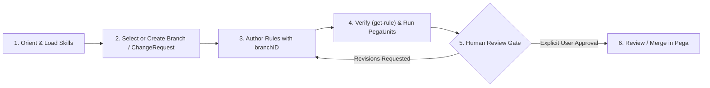

# Governed Branch & `ChangeRequest` Authoring Lifecycle

Pega Infinity Authoring enforces enterprise governance by routing external agent rule mutations through isolated **branch rulesets** (`branchID`) and **ChangeRequest** workflows rather than mutating base production rulesets directly.

## 1. Selecting, Creating, or Resuming a Branch / `ChangeRequest`

- **Load `methodology-rule-authoring` first**: Always call `get-skill` for `methodology-rule-authoring` (plus the target `rules-<objclass>` skill and a top-level `examples/*` template) so branch setup, deep-merge semantics (`listUpdateMode` / `listUpdateModeOverrides`), and payload fields match the connected Infinity version (`24-2`, `25-1`, or `26-1`).
- **Branch selection & validation**:
  - Confirm with the user whether to reuse an existing branch / `ChangeRequest` or create a new branch via `D_pxCreateBranchAndAddToTopApplication`.
  - Always ask for **explicit user confirmation** before adding an existing branch to the top application with `D_pxAddExistingBranchToTopApplication`.
  - Validate `branchID` format: 3–16 characters, alphanumeric first character, `[A-Za-z0-9_-]` only, and never prefixed with `px`, `py`, or `pz`.
- **Durable branch context**: Read `D_pxBranchContext` at the start of work on a branch and record milestone progress or deferred notes via `D_pxUpdateBranchContext` when available.

## 2. Safe Mutation Rules Inside a Branch / `ChangeRequest`

1. **Bottom-up rule creation**: Create foundational classes and properties before referencing them inside Data Transforms, Validation rules, Views, or Case Lifecycles. Pega validates property and class existence at save time.
2. **Idempotent deep-merge updates**: Read existing rule definitions via `get-rule` (`detail="full"`) before calling `update-rule` so you preserve sibling fields, choose the right `listUpdateMode` (`"patch"` vs `"replace"`), and pass a concise `changeDescription`. Use `copy-rule` only when the user explicitly requests Save As behavior.
3. **Verify & surface all warnings**: Confirm every write with `get-rule` (`detail="full"`) and explicitly report every `warnings` and `validationWarnings` entry returned by `create-rule`, `update-rule`, or `copy-rule`.

## 3. Pre-Review Verification Checklist

Before presenting work for human approval, verify:
- [ ] Every created or modified rule was verified via `get-rule(detail="full")` and any returned `warnings` / `validationWarnings` are surfaced transparently.
- [ ] Custom rules and branch IDs follow Pega naming guardrails (no `px`/`py`/`pz` prefixes; `D_` prefix for Data Pages).
- [ ] Relevant branch-scoped PegaUnit tests (`run-pegaunits` with `branchID`) or Data Page smoke checks were executed where available.
- [ ] No hardcoded environment URLs, credentials, or operator IDs exist inside Data Transforms, Connectors, or Decision rules (use Dynamic System Settings or Application Settings).

## 4. Human-in-the-Loop Approval Gate

- **Pause before review completion or merge**: Present the `branchID` / `ChangeRequest` ID, rule inventory, warnings, and test outcomes to the user.
- **Wait for explicit confirmation**: Leave branch review/merge to standard Pega branch management, and only invoke review-approval, branch-merge, or publish actions after the user explicitly instructs you to proceed.
